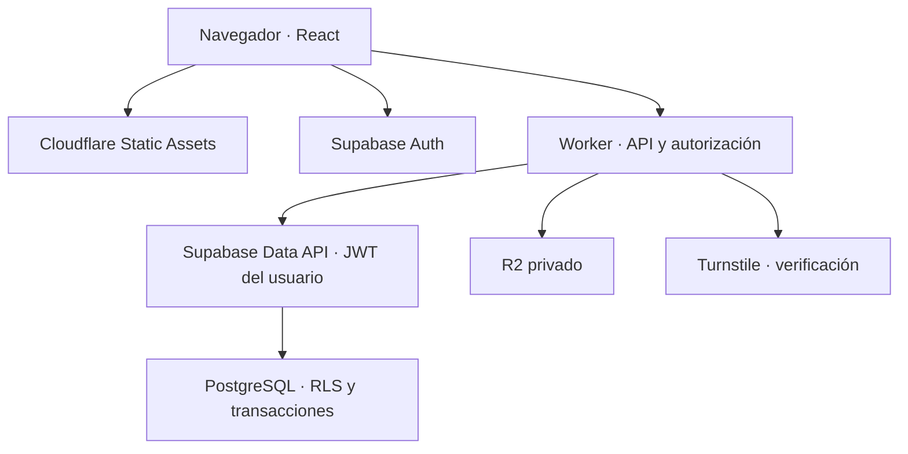

# TallerOS — propuesta técnica para validar

Versión 0.4 · 10 de octubre de 2026 · entrega de Fase 2 pendiente de validación SQL/RLS

Estado: Fase 1 completada y revisada por el usuario. Únicamente Fase 2 autorizada: Auth, onboarding, workshops, membresías, invitaciones y RLS. Fase 3 todavía no autorizada. Fase 2 no puede declararse completada sin tests SQL/RLS aprobados realmente en CI o entorno compatible. La implementación de Fase 2 está entregada para revisión, pero sus migraciones no se aplicaron y los tests SQL/RLS e integración real no pudieron ejecutarse por ausencia de Docker/Podman. No hubo despliegue. Los ejemplos SQL de fases futuras siguen siendo ilustrativos. Ver `docs/phase-2.md` para la evidencia y los riesgos abiertos.

## 1. Decisión general

Construir un monolito modular: React SPA, una API TypeScript en Cloudflare Workers, PostgreSQL y Auth en Supabase, y un bucket privado R2. Una base compartida con aislamiento por taller mediante RLS y claves compuestas es suficiente para el MVP.

El frontend usará Supabase directamente para autenticación. Todos los datos de negocio pasarán inicialmente por el Worker. El Worker enviará a la Data API de Supabase el JWT del usuario, preservando sus restricciones RLS. No usará una clave administrativa para el CRUD cotidiano.

Operaciones con varias escrituras —crear taller, ingreso express, cambiar estado, enviar o aprobar presupuesto— se ejecutarán mediante funciones PostgreSQL transaccionales. Varias llamadas HTTP consecutivas a Supabase no constituyen una transacción.

Esta separación permite reemplazar el runtime del Worker por otro servidor que soporte Fetch, el almacenamiento por un proveedor S3 compatible y PostgreSQL por otra instalación. Migrar Auth requiere trabajo específico; portabilidad no significa ausencia total de dependencia.

## 2. Arquitectura y límites de confianza

Diagrama textual: navegador → Static Assets para HTML/JS/CSS; navegador → Supabase Auth para sesión; navegador → Worker API con Bearer JWT → Supabase Data API/RPC → PostgreSQL con RLS. El Worker también accede a R2 privado y verifica Turnstile en operaciones protegidas.



El taller seleccionado en la URL es contexto, nunca prueba de autorización. El Worker verifica membresía activa en cada operación; PostgreSQL vuelve a comprobar el acceso. Los permisos se leen de la base, no de roles que puedan quedar obsoletos dentro de un JWT.

### Acceso directo a Supabase

| Operación                               | Ruta inicial                             | Motivo                                                                                               |
| --------------------------------------- | ---------------------------------------- | ---------------------------------------------------------------------------------------------------- |
| Registro, login, recuperación y refresh | SDK de Auth                              | Evita desarrollar un sistema de sesiones propio                                                      |
| Lectura de datos de negocio             | Worker + JWT + RLS                       | Contrato uniforme, paginación, DTO y observabilidad                                                  |
| Escritura simple                        | Worker + JWT + RLS                       | Validación y autorización consistentes                                                               |
| Escritura con invariantes               | Worker + RPC transaccional               | Atomicidad y protección frente a concurrencia                                                        |
| Portal público                          | Worker + clave pública + RPC restringida | SECURITY DEFINER privada valida token y capacidad de gateway; devuelve únicamente proyección pública |
| Archivos                                | Worker autorizado                        | Bucket privado y visibilidad controlada                                                              |

Una lectura directa podría ser segura con RLS, permisos de columnas y vistas correctas, pero no aporta suficiente ventaja inicial. La Data API continúa siendo accesible externamente: nadie debe poder saltarse reglas llamándola sin pasar por el Worker. Las reglas críticas viven también en SQL, grants y funciones, no únicamente en TypeScript.

## 3. Repositorio propuesto

Un repositorio, npm workspaces, TypeScript strict, lockfile versionado. No se necesita un sistema de monorepo adicional.

| Ubicación              | Responsabilidad                                                            |
| ---------------------- | -------------------------------------------------------------------------- |
| `apps/web/`            | React, Vite, Router, Tailwind, componentes accesibles, Query y formularios |
| `apps/api/`            | Entrypoint Worker, middleware, rutas, servicios y adaptadores              |
| `packages/contracts/`  | Zod, tipos de DTO, estados y claves de permisos compartidas                |
| `supabase/migrations/` | Esquema, constraints, grants, RLS y funciones versionadas                  |
| `supabase/tests/`      | Tests reales SQL de aislamiento y reglas de negocio                        |
| `supabase/seed.sql`    | Datos ficticios para desarrollo                                            |
| `tests/e2e/`           | Flujos completos con Playwright                                            |
| `docs/`                | Arquitectura, decisiones y operación                                       |
| `.github/workflows/`   | Checks y despliegue con ambiente protegido                                 |

ESLint, Prettier, Vitest y scripts raíz para typecheck, lint, test y build. Contratos compartidos no contienen código privilegiado ni secretos. Los permisos de UI sirven para orientar; la autorización real se aplica en backend y base.

Nombre y branding centralizados en configuración. R2 y rate limiting detrás de adaptadores pequeños. No incorporar Redux, Redis, colas, microservicios ni Kubernetes.

## 4. Modelo de datos

UUID para identidades, `timestamptz` para instantes, zona horaria IANA en taller —por defecto `America/Argentina/Buenos_Aires`— y fechas locales calculadas con esa zona. `created_at` y `updated_at` los genera la base. Actores y taller se derivan de la sesión/contexto validado.

| Tabla                       | Relaciones y campos relevantes                                                                                                                |
| --------------------------- | --------------------------------------------------------------------------------------------------------------------------------------------- |
| `profiles`                  | PK = `auth.users.id`; nombre visible. Sin roles globales de taller                                                                            |
| `workshops`                 | Nombre, contactos, dirección, CUIT opcional, zona horaria, moneda ARS, referencia a logo privado                                              |
| `workshop_members`          | Taller + usuario únicos; rol OWNER/RECEPTION/MECHANIC, estado activo/inactivo                                                                 |
| `workshop_invitations`      | Taller, email normalizado, rol, hash de token, vencimiento, aceptación y revocación                                                           |
| `customers`                 | Taller, nombre, apellido, teléfono/WhatsApp normalizados, email, tax_id, dirección, notas internas y `archived_at timestamptz NULL`           |
| `vehicles`                  | Taller + cliente; patente normalizada, marca/modelo/año, VIN, kilometraje y `archived_at timestamptz NULL`                                    |
| `appointments`              | Taller + cliente + vehículo opcional; inicio, `duration_minutes integer NOT NULL`, motivo, notas, estado y orden vinculada opcional           |
| `work_orders`               | Taller + cliente + vehículo; número local, membresía asignada, ingreso, kilometraje, motivo, fecha prevista, estado y `revision`              |
| `work_order_status_history` | Taller + orden; estado anterior/nuevo, actor interno o tipo de actor externo, instante                                                        |
| `diagnoses`                 | Taller + orden únicos; diagnóstico compartido y notas internas en campos separados                                                            |
| `work_order_items`          | Taller + orden; LABOR/PART/SERVICE/OTHER, descripción, cantidad, importe, estado y referencia opcional al ítem presupuestado                  |
| `estimates`                 | Taller + orden; versión, estado, moneda, descuento, vencimiento, `revision`, envío y resolución                                               |
| `estimate_items`            | Taller + presupuesto; posición, tipo, descripción, cantidad, precio y decisión individual                                                     |
| `estimate_events`           | Taller + presupuesto; envío/aprobación/rechazo, actor, versión, selección y fecha                                                             |
| `vehicle_recommendations`   | Taller + vehículo + orden origen opcional; descripción, prioridad y estado pendiente/resuelto/descartado                                      |
| `attachments`               | Taller + orden; autor, key R2 única, MIME, tamaño, categoría, visibilidad y estado pendiente/listo                                            |
| `public_access_tokens`      | Taller + presupuesto/orden; hash único, alcance, vencimiento, revocación y versión autorizada                                                 |
| `idempotency_keys`          | Taller opcional para onboarding, actor/capacidad, operación, hash de key, hash de request canónico, resultado mínimo, timestamps y expiración |
| `audit_logs`                | Taller, tipo de evento, recurso, actor, request_id y metadata mínima                                                                          |

`workshop_invitations` es una adición necesaria para incorporar empleados sin permitir altas arbitrarias de membresías. Todas las tablas del pedido tienen una responsabilidad concreta. No se necesita una tabla de historial de vehículo adicional: se construye con órdenes entregadas e ítems finalizados.

### Integridad entre talleres y relaciones

Cada entidad de taller tiene `workshop_id NOT NULL` y `UNIQUE(workshop_id, id)`. Las relaciones emplean FKs compuestas:

```sql
-- Ejemplo ilustrativo, no migración completa.
alter table public.customers add unique (workshop_id, id);
alter table public.vehicles
  add foreign key (workshop_id, customer_id)
  references public.customers (workshop_id, id);
```

Órdenes y turnos deben además asegurar que el vehículo corresponde al cliente indicado mediante una FK `(workshop_id, vehicle_id, customer_id)` a una clave única equivalente en vehículos. Si se permite transferir un vehículo de cliente, se conservará la titularidad histórica de órdenes y se cambiará este diseño antes de implementar; el MVP no permite transferencias directas que reescriban el historial.

Asignación de mecánico referencia una membresía del mismo taller. La función de asignación comprueba actividad y rol apto, y evita que un cliente asigne un usuario arbitrario. Desactivar un empleado conserva sus referencias históricas.

Normalizar patente en la base con mayúsculas y eliminación de espacios/guiones. Validar caracteres y longitud; no eliminar silenciosamente cualquier carácter inválido. `UNIQUE(workshop_id, normalized_license_plate)`. Teléfono normalizado para búsqueda; no único porque familias y empresas pueden compartirlo.

No eliminar en cascada historial de operaciones. Clientes y vehículos tienen archivado explícito con `archived_at`; las listas activas filtran `IS NULL`, mientras las fichas históricas conservan acceso autorizado. Archivar no libera la patente única: reactivar el vehículo existente evita duplicados. No se concede DELETE físico a usuarios cuando exista historial; el MVP usa archivado también para registros sin historial. Bloquear nuevas órdenes/turnos sobre clientes o vehículos archivados. Archivar cliente requiere resolver o archivar sus vehículos activos mediante una operación explícita; nunca ocultarlos silenciosamente. Talleres y cuentas requieren una política de retención y eliminación posterior explícita.

### Importes y numeración

Precios y totales en unidades menores enteras —centavos—, cantidades `numeric(12,3)`, moneda explícita, límites de magnitud y cantidades positivas. API usa representación que no pierda precisión al cruzar JSON; cálculo financiero SQL con decimal exacto. Redondear cada subtotal al centavo, sumar subtotales y aplicar descuento fijo validado entre cero y subtotal. No admitir porcentajes y descuentos acumulados inicialmente.

Una secuencia lógica por taller, incrementada con bloqueo dentro de una función, genera `order_number`; `UNIQUE(workshop_id, order_number)`. Nunca usar `MAX()+1`. UUID identifica el recurso; el número es únicamente referencia humana.

Índices iniciales: membresías `(user_id, workshop_id)`, vehículos `(workshop_id, normalized_license_plate)`, órdenes `(workshop_id, status, created_at, id)`, asignación, turnos `(workshop_id, starts_at, id)`, presupuestos por orden/version, historial por orden/fecha y hash de tokens. Búsqueda por nombre usa `pg_trgm` cuando se implemente búsqueda parcial; verificar planes con datos representativos.

### Duración de turnos

Elegir `duration_minutes integer NOT NULL DEFAULT 60`, con CHECK entre 5 y 1440. `ends_at` se deriva como `starts_at + duration_minutes * interval '1 minute'`; no se almacena una segunda fuente de verdad. Es simple para editar turnos y expresa duración real aunque cambie la zona horaria. Indexar inicio; si se exige impedir solapamientos por mecánico/recurso en el futuro, incorporar asignación y constraint de rango en esa fase. El MVP no promete exclusividad de agenda por no tener aún recursos asignados.

### Idempotencia persistida

Tabla privada `idempotency_keys`: UUID, `workshop_id` nullable sólo para onboarding, `actor_scope` no nulo (usuario autenticado o ID de token público; nunca token crudo), `operation`, `key_hash`, `request_hash`, `resource_id`, `response_status`, `response_json` mínimo, `created_at`, `completed_at`, `expires_at`. Unique `(actor_scope, operation, key_hash)`; para operaciones de taller el scope incluye también workshop_id canónico. Body canónico calculado/validado por servidor/SQL, incluye versión/ítems/parámetros relevantes; no confiar en hash del navegador. No persistir contraseñas, JWT, gateway ni tokens públicos en respuestas.

Cliente genera key aleatoria UUID por intención y la conserva durante reintentos; encabezado `Idempotency-Key`, longitud limitada. Alta de taller/ingreso, cambios de estado, envío y decisiones requieren key. Dentro de la misma transacción SQL: validar actor/permisos/capacidad vigente → INSERT de reserva con unique → ejecutar mutación → guardar resultado y completed_at → COMMIT. La reserva sin completar nunca queda comprometida: rollback revierte ambas. Dos requests iguales compiten en el índice único; el segundo espera el commit, compara hash y devuelve resultado anterior. Mismo key con request distinto → 409 IDEMPOTENCY_KEY_REUSED. Fallo transitorio de transacción no consume key; timeout de bloqueo devuelve conflicto reintentable, no ejecuta una segunda mutación.

TTL de replay propuesto: 24 horas desde creación. Mantener tombstone con hashes y resource_id durante 30 días; después de vencer replay, responder 409 IDEMPOTENCY_KEY_EXPIRED sin reejecutar, retirando response_json. Limpiar por mantenimiento diario con índice expires_at; después de 30 días borrar metadata. Una key puede volver a ser nueva después de esa retención: API documenta ventana y cliente nunca reutiliza keys. Constraints de negocio/versiones/terminalidad protegen resoluciones aun después de purga. Reintentos revalidan autorización y token actual antes de devolver resultado: revocación no se ignora por caché. `workshop_id` para onboarding se completa al crear taller.

El envío de presupuesto genera token crudo sólo en memoria; no guardar enlace secreto en response_json. Un reintento obtiene estado/recurso de envío pero no recupera el token; puede requerir una rotación explícita de enlace que revoque el anterior. Documentar ese comportamiento para evitar persistir credenciales en la tabla. R2 es un flujo compensado separado: la idempotencia SQL no promete atomicidad de red/objeto.

## 5. Multi-tenancy y RLS

Activar RLS en todas las tablas expuestas con datos privados. No conceder acceso a `anon`. Roles SQL y permisos de tablas limitan operaciones incluso cuando exista una política permissiva. La ausencia de una policy autorizadora implica denegación.

Helper de membresía en esquema `private`, que no se expone por Data API. Evita una política recursiva sobre `workshop_members`. Su propietario tiene únicamente los privilegios necesarios para consultar membresías sin entrar en recursión; `search_path` fijo y SQL con nombres calificados. Supabase documenta el cuidado especial requerido por `SECURITY DEFINER` [S2].

```sql
create schema if not exists private;

create function private.has_role(p_workshop uuid, p_roles text[])
returns boolean
language sql stable security definer
set search_path = ''
as $$
  select exists (
    select 1 from public.workshop_members m
    where m.workshop_id = p_workshop
      and m.user_id = (select auth.uid())
      and m.is_active
      and m.role::text = any(p_roles)
  );
$$;

revoke all on function private.has_role(uuid, text[]) from public;
grant usage on schema private to authenticated;
grant execute on function private.has_role(uuid, text[]) to authenticated;

alter table public.customers enable row level security;

create policy customers_read on public.customers
for select to authenticated
using (private.has_role(workshop_id, array['OWNER','RECEPTION']));

create policy customers_insert on public.customers
for insert to authenticated
with check (private.has_role(workshop_id, array['OWNER','RECEPTION']));

create policy customers_update on public.customers
for update to authenticated
using (private.has_role(workshop_id, array['OWNER','RECEPTION']))
with check (private.has_role(workshop_id, array['OWNER','RECEPTION']));
```

Este ejemplo supone las columnas definidas arriba. La migración real incluye propietario de funciones, grants mínimos y tests. Un trigger prohíbe modificar `workshop_id` y campos de identidad: una persona miembro de A y B tampoco debe poder trasladar registros entre ellos.

MECHANIC puede leer únicamente órdenes asignadas y sus datos técnicos necesarios. No obtiene acceso general a clientes, presupuestos ni notas comerciales. Las lecturas relacionadas de diagnósticos/ítems/fotos/recomendaciones verifican asignación sobre la orden padre.

RLS controla filas, no ocultamiento de columnas. Separar información financiera y técnica mediante grants/vistas `security_invoker` o tablas cuando sea necesario. Los DTO del Worker no sustituyen esta restricción: la Data API no debe exponer al mecánico campos que el Worker oculta. Miembros ven perfiles mínimos de compañeros por una proyección controlada; `profiles` completo es accesible sólo al propio usuario.

Para tablas críticas, retirar INSERT/UPDATE/DELETE directos al rol `authenticated`. Funciones invoker preservan RLS para lecturas/escrituras permitidas; operaciones que necesitan privilegios adicionales usan una implementación privada definer muy acotada, con wrapper invoker expuesto, identidad comprobada, grants mínimos y validaciones internas completas. Auditar todas las entradas, sin SQL dinámico arbitrario. No exponer helpers privilegiados en esquemas de la Data API.

### Portal sin service_role: alternativa elegida

No se utilizará `SUPABASE_SERVICE_ROLE_KEY` en el runtime. Supabase permite llamar RPC y definir permisos de ejecución [S7]. El Worker empleará la clave pública para llamar wrappers `SECURITY INVOKER` en el esquema API; éstos delegan en funciones `SECURITY DEFINER` privadas extremadamente acotadas: lectura pública, decisión y autorización de foto. Se revoca EXECUTE a PUBLIC por defecto y se concede sólo el necesario a anon/authenticated para estos wrappers y sus delegados. El esquema private no se expone por Data API. Ningún wrapper acepta nombre de tabla, SQL, tenant arbitrario ni filtros genéricos.

Cada función privada valida **dos capacidades**: token del cliente —calcula SHA-256 dentro de PostgreSQL y compara con hash almacenado— y secreto dedicado `PORTAL_RPC_GATEWAY_KEY`, aleatorio de 32 bytes, cuyo hash se guarda en configuración privada mediante migración/configuración operativa segura. Esta segunda capacidad evita que llamadas directas con clave pública/token salten rate limiting y Turnstile del Worker. No es una credencial administrativa: sólo habilita las tres RPC de portal, no puede consultar tablas ni administrar Auth. Nunca se envía al navegador, no se registra y se rota separadamente. La comparación de hashes exige longitud/formato válido; registrar el secreto no equivale a introducirlo como literal en Git. Rotación admite dos hashes durante una ventana corta si se necesita transición.

Propietario dedicado NOLOGIN para las funciones, sin superusuario, sin BYPASSRLS, sin propiedad sobre tablas. Conceder columnas y operaciones mínimas sobre tablas requeridas, con políticas RLS explícitas para ese rol; token/config privada inaccesibles a anon/authenticated. Este rol no se asigna a usuarios ni al autenticador de PostgREST. `search_path = ''`, nombres calificados, sin SQL dinámico. Las políticas del rol técnico permiten la lectura necesaria; la función valida alcance/token antes de cualquier proyección o escritura. Se auditan las funciones como frontera privilegiada, no se afirma que la membresía RLS autorice al cliente externo.

La RPC resuelve taller/orden/presupuesto exclusivamente desde el token activo y valida versión/vencimiento/revocación. Devuelve JSON construido campo por campo; nunca `SELECT *`, tipos de filas completas ni `to_jsonb(row)`. La decisión bloquea token y presupuesto en orden fijo para que revocación y aprobación concurrentes tengan serialización definida. La RPC de foto sólo devuelve al Worker descriptor de objeto permitido, nunca el secreto ni información interna al navegador. DTO y tests mantienen allowlist adicional.

Esta alternativa es razonablemente simple: un secreto acotado y tres funciones, sin clave con acceso administrativo. Si aparecen límites de privilegios del proveedor durante implementación se documentará evidencia antes de cambiar la decisión, sin añadir silenciosamente service_role. Pruebas directas a Data API deben comprobar denegación sin gateway, sin token o con cualquiera de ellos inválido. Los límites de negocio SQL siguen vigentes incluso con gateway válido.

## 6. Autenticación y membresías

1. Registro con email y contraseña mediante Supabase Auth; confirmación de email antes de habilitar operaciones del taller. Captcha de Auth cuando esté configurado; un wrapper Worker por sí solo no protege un endpoint Auth accesible directamente.
2. Login mediante SDK. Sesión con access token breve y refresh gestionado por Supabase. Worker verifica firma y claims, emisor, expiración y audiencia con librería oficial o `jose`; no basta decodificar el JWT [S3].
3. Consulta de membresías propias. Sin talleres: onboarding. Uno: abrirlo. Varios: selector; persistir sólo preferencia de UI.
4. Crear taller y membresía OWNER atómicamente; actor derivado de `auth.uid()`. Idempotency key para evitar talleres duplicados por doble envío.
5. OWNER crea invitación con rol permitido, token aleatorio de un solo uso y vencimiento. El destinatario se autentica con email verificado coincidente; aceptar consume invitación y crea membresía en una transacción. No enviar invitaciones reales durante desarrollo.
6. Recuperación por email con redirects permitidos exactamente; callback valida flujo de recuperación antes de cambiar contraseña.
7. Logout cancela queries, elimina caché y termina sesión. Desactivación de membresía bloquea nuevas operaciones aunque el access token siga vigente. Un JWT válido puede sobrevivir al cierre de sesión hasta expirar: validar sesión remotamente para operaciones administrativas sensibles si se requiere revocación inmediata.

Para una SPA simple, mantener la sesión mediante SDK implica tokens accesibles a JavaScript. Se acepta este compromiso inicial con CSP estricta, sin scripts arbitrarios y prevención XSS. No afirmar que la sesión usa cookies HttpOnly. Un BFF con cookies sería una decisión posterior distinta, con gestión de refresh y CSRF.

## 7. Permisos y estados

| Capacidad                           | OWNER             | RECEPTION         | MECHANIC                        |
| ----------------------------------- | ----------------- | ----------------- | ------------------------------- |
| Configurar taller y membresías      | Sí                | No                | No                              |
| Clientes y vehículos                | Sí                | Sí                | Datos mínimos en orden asignada |
| Turnos e ingreso                    | Sí                | Sí                | No                              |
| Crear orden/asignar mecánico        | Sí                | Sí                | No                              |
| Diagnóstico, ítems técnicos y fotos | Sí                | Sí                | Sólo orden asignada             |
| Crear/enviar presupuesto            | Sí                | Sí                | No                              |
| Registrar aceptación por teléfono   | Sí, con evidencia | Sí, con evidencia | No                              |
| Aprobar desde portal                | Cliente con token | Cliente con token | Cliente con token               |
| Marcar trabajo terminado            | Sí                | Sí                | Sólo orden asignada             |
| Entregar/cancelar orden             | Sí                | Sí                | No                              |
| Auditoría/configuración sensible    | Sí                | No                | No                              |

Permisos con claves como `orders.assign`, `orders.diagnose`, `estimates.send`; resolver centralmente rol + recurso + estado. Matriz TypeScript y SQL deben concordar mediante tests contractuales. No construir un editor de roles personalizados en el MVP.

Transiciones propuestas: RECEIVED → DIAGNOSIS → WAITING_APPROVAL → APPROVED → IN_PROGRESS → COMPLETED → READY_FOR_DELIVERY → DELIVERED. IN_PROGRESS ↔ WAITING_PART. DIAGNOSIS/WAITING_APPROVAL pueden pasar a CANCELLED por recepción/owner. Otros retrocesos o cancelaciones necesitan motivo y permiso explícito; DELIVERED y CANCELLED son terminales inicialmente.

APPROVED requiere presupuesto vigente aceptado o registro interno trazable de autorización. Una aprobación parcial usa formalmente `estimate.status = PARTIALLY_APPROVED`. Si al menos un ítem queda aceptado, la orden puede pasar a APPROVED únicamente si su transición vigente lo permite; sólo esos ítems quedan autorizados para ejecución. Los rechazados pueden convertirse en recomendaciones pendientes con referencia única a su ítem de presupuesto, sin duplicados por reintento. Un presupuesto rechazado no cancela automáticamente la orden. Al enviar una nueva versión, la anterior deja de ser accionable; no añadir estado SUPERSEDED sin definir cómo se refleja esa invalidación.

Cambio de estado: bloquear orden, comparar `expected_revision`, verificar transición y rol, actualizar revisión, insertar historial y auditoría en una sola transacción. Conflicto devuelve 409 y obliga a recargar. Historial y auditoría sin UPDATE/DELETE para usuarios; una corrección agrega evento, no borra el anterior.

## 8. Presupuestos y portal público

Versiones de presupuesto únicas por orden. DRAFT editable; SENT conserva descripción, cantidades, precios, moneda y descuento congelados. Una modificación crea nueva versión. El servidor recalcula totales; nunca acepta un total suministrado por frontend.

### Resolución parcial formal

Cada ítem debe recibir ACCEPTED o REJECTED en una resolución final completa; no se permite selección ambigua ni ítems ajenos. Todos aceptados → APPROVED; mezcla con al menos uno aceptado y uno rechazado → PARTIALLY_APPROVED; ninguno aceptado → REJECTED. No se envían presupuestos vacíos. La decisión es final para esa versión y no permite ampliar permisos por editar un ítem después.

El estado de orden APPROVED sólo habilita ítems vinculados a decisiones ACCEPTED de la versión vigente; el check se aplica dentro de SQL al comenzar/finalizar ítems, no sólo en botones. LABOR/PART/SERVICE/OTHER rechazados no se ejecutan. Trabajos nuevos requieren una nueva autorización. Estado WAITING_APPROVAL puede avanzar a APPROVED con presupuesto parcial; estados terminales no se reabren por el portal. Si la orden no permite la transición, la resolución falla atómicamente, sin dejar aceptación registrada a medias.

Descuento fijo se distribuye entre ítems proporcionalmente al subtotal mediante algoritmo de restos mayores en centavos, desempate por posición/id; se congela al enviar. Total autorizado = suma de importes netos congelados de ítems aceptados. Así una aceptación parcial no recibe todo el descuento del presupuesto ni produce resultados distintos por redondeo. Recomendaciones rechazadas se crean mediante acción interna explícita y trazable, con `source_estimate_item_id` único por taller.

Token generado con 32 bytes criptográficos aleatorios, codificado base64url, almacenando únicamente hash SHA-256. Alcance a una orden y versión de presupuesto; expiración propuesta de 7 días, configurable, revocable. Rotación invalida el anterior. El token no identifica a una persona: prueba posesión del enlace y se registra como aceptación externa, sin afirmar que es una firma digital.

Entrada `/p/:token` sin analytics ni recursos externos, `Referrer-Policy: no-referrer`, `Cache-Control: no-store` y `X-Robots-Tag: noindex`. Redactar token de logs, errores y telemetría; revisar también registros de acceso de la plataforma. La SPA captura el token y limpia la URL con `history.replaceState`, manteniéndolo sólo en memoria; al recargar se debe reabrir el enlace original. API recibe token en encabezado, nunca lo incorpora a logs. GET nunca aprueba/rechaza: vistas previas de WhatsApp no deben cambiar datos.

POST de decisión transmite versión/revisión y selección explícita de ítems. La función bloquea presupuesto, valida token activo y vinculado, comprueba estado SENT y vencimiento, rechaza IDs ajenos/duplicados, calcula decisión y total autorizado, registra evento y transición pertinente. Aprobación y rechazo simultáneos: sólo una resolución puede ganar. Reintento con la misma idempotency key devuelve el resultado previo; una decisión diferente posterior devuelve conflicto.

DTO público con allowlist: taller y contacto comercial, marca/modelo/patente, estado público simplificado, diagnóstico compartido, fotos visibles y presupuesto. Excluir notas internas, clientes ajenos, costos y usuarios internos. Probar ausencia de estos campos incluso ante cambios del esquema.

## 9. API REST

Prefijo `/api/v1`. Workshop explícito en rutas privadas para soportar pertenencia múltiple. Todas validan JWT, membresía, permiso, input y recurso.

| Endpoints principales                                          | Uso                                            |
| -------------------------------------------------------------- | ---------------------------------------------- |
| `GET /me`, `GET /workshops`                                    | Perfil mínimo y talleres accesibles            |
| `POST /workshops`                                              | Onboarding atómico                             |
| `GET/PATCH /workshops/:wid`                                    | Datos/configuración                            |
| `GET /workshops/:wid/members`                                  | Equipo permitido                               |
| `POST /workshops/:wid/invitations`, `POST /invitations/accept` | Invitación y aceptación                        |
| `PATCH /workshops/:wid/members/:mid`                           | Cambio de rol/actividad; proteger último OWNER |
| `GET/POST /workshops/:wid/customers`                           | Búsqueda paginada y alta                       |
| `GET/PATCH /workshops/:wid/customers/:id`                      | Ficha y actualización                          |
| `GET/POST /workshops/:wid/vehicles`                            | Búsqueda/alta                                  |
| `GET/PATCH /workshops/:wid/vehicles/:id`                       | Ficha e historial paginado                     |
| `POST /workshops/:wid/check-ins`                               | Ingreso express transaccional                  |
| `GET/POST /workshops/:wid/work-orders`                         | Lista/creación                                 |
| `GET /workshops/:wid/work-orders/:id`                          | Detalle permitido                              |
| `PATCH /workshops/:wid/work-orders/:id/status`                 | Transición con revisión                        |
| `PATCH /workshops/:wid/work-orders/:id/assignment`             | Asignación                                     |
| `PUT /workshops/:wid/work-orders/:id/diagnosis`                | Diagnóstico                                    |
| `POST/PATCH /workshops/:wid/work-orders/:id/items[/:itemId]`   | Ítems validados                                |
| `POST /workshops/:wid/work-orders/:id/estimates`               | Borrador o nueva versión                       |
| `POST /workshops/:wid/estimates/:id/send`                      | Congelar y emitir enlace                       |
| `POST /workshops/:wid/estimates/:id/decision`                  | Autorización interna con motivo                |
| `POST/GET /workshops/:wid/work-orders/:id/attachments`         | Upload y listado                               |
| `GET /workshops/:wid/attachments/:id/content`                  | Descarga autorizada                            |
| `POST /workshops/:wid/public-access/:id/revoke`                | Revocar enlace                                 |
| `GET/POST/PATCH /workshops/:wid/appointments[/:id]`            | Turnos                                         |
| `GET /workshops/:wid/search`, `GET /workshops/:wid/dashboard`  | Búsqueda limitada y agregados                  |
| `GET /public/estimate`, `POST /public/estimate/decision`       | Portal con token en encabezado                 |
| `GET /public/attachments/:id/content`                          | Foto visible con token                         |

Errores `{error:{code,message,request_id}}`; validaciones pueden incluir errores por campo sin detalles SQL. 401 sesión inválida; 403 permiso insuficiente; 404 recurso inexistente o ajeno para evitar enumeración; 409 duplicado/revisión; 413 tamaño; 422 validación; 429 límite; 500 mensaje genérico.

Paginación por cursor `(created_at,id)` o `(starts_at,id)`, límites de 25 por defecto/100 máximo. Búsqueda limitada por categoría, debounce de 300 ms y cancelación de requests antiguos. No devolver todo el taller ni exponer filtros SQL arbitrarios. Check-in no fusiona clientes automáticamente por teléfono: muestra coincidencias y pide selección si son ambiguas.

## 10. Archivos en R2

Bucket privado, sin endpoint público. Key generada por servidor: `workshops/{wid}/orders/{orderId}/{attachmentId}`; nunca confiar en una key enviada por el navegador. Logo usa namespace propio y control OWNER.

MVP: uploads y descargas mediante Worker autorizado, con streaming de extremo a extremo siempre que sea posible [S8]. PUT con cuerpo binario de una imagen, metadata validada aparte; no usar `request.formData()`, `arrayBuffer()` ni buffers completos del archivo. Un transform cuenta bytes y corta al exceder cuota, verificando prefijo con buffer pequeño y acotado; Content-Length sólo es comprobación adicional, no confiable. Autorización/cuota y metadata PENDING se resuelven antes de leer el cuerpo. R2 put recibe ReadableStream; confirmar requisitos de longitud del SDK/binding y aplicar stream de longitud fija cuando corresponda. Si se requiere, exigir longitud declarada y verificarla durante el stream. La validación incremental de estructura/dimensiones debe ser compatible con stream; si un formato requiere verificación posterior, guardar en cuarentena PENDING y validar leyendo desde R2 con memoria limitada antes de READY. No usar tee con consumidor lento que acumule bytes. Un error de tamaño/validación o desconexión cancela flujo y elimina objeto parcial/huérfano; nunca marcar READY. No se implementa decoder/transcodificador de imágenes en Fase 1. Reduce complejidad de URLs firmadas y permite aplicar revocación en cada lectura. Adaptador S3 compatible o binding R2 encapsulado; el binding tiene ventaja clara de integración, pero no debe filtrarse al dominio.

Aceptar inicialmente JPEG/PNG/WebP, hasta 8 MiB y 20 megapíxeles por imagen, con límites configurables por orden y taller. No aceptar SVG, HTML, ejecutables ni PDF en esta primera versión. Comprobar extensión, MIME declarado, bytes de firma y estructura/dimensiones; ninguno por separado garantiza seguridad. Conversiones opcionales en cliente mejoran UX, pero el servidor aplica límites independientemente. Requerir conversión de HEIC desde iPhone, o agregar soporte real y validado antes de habilitarlo.

Crear metadata PENDING, subir objeto, verificar y marcar READY; sólo READY se puede mostrar. Compensar borrando objeto ante fallo de metadata. R2 y PostgreSQL no comparten transacción: una tarea de mantenimiento elimina uploads pendientes y objetos huérfanos con margen de seguridad. No reescribir un objeto publicado bajo la misma key.

Lectura verifica membresía/asignación, o token vigente + orden vinculada + `is_customer_visible`. Servir Content-Type fijo validado y `nosniff`; sin caché pública para archivos privados. Si más adelante se usan URLs firmadas, TTL breve y reconocer que no se revocan inmediatamente mientras sigan vigentes.

## 11. Frontend y experiencia mobile

React Router con rutas lazy, TanStack Query, RHF/Zod y componentes Radix/shadcn equivalentes accesibles. Estructura por features: auth, workshops, customers, vehicles, orders, estimates, appointments, dashboard y portal.

Rutas: `/login`, `/register`, `/forgot-password`, `/auth/callback`, `/reset-password`, `/onboarding`, `/select-workshop`; `/w/:wid/dashboard`, `/customers`, `/customers/:id`, `/vehicles`, `/vehicles/:id`, `/orders`, `/orders/new`, `/orders/:id`, `/appointments`, `/settings`, `/team`, `/search`; `/p/:token`. Subrutas de negocio dentro de `/w/:wid`.

Sidebar desktop; navegación inferior móvil con Hoy, Órdenes, Turnos y Más, más acceso claro a ingreso express. Ficha de orden organiza resumen, diagnóstico, trabajos, presupuesto e historial sin formularios interminables. Touch targets de al menos 44 px, foco visible, etiquetas, errores junto al campo, contraste y estados con texto además de color. Respetar reduced motion.

Cada query key contiene usuario y workshop_id. Cambiar taller cancela requests y limpia datos sensibles del contexto anterior; logout elimina toda la caché. No persistir información comercial en localStorage. No aprobar presupuesto ni cambiar estado mediante actualización optimista ciega; confirmar con respuesta del servidor.

Dashboard con contadores navegables, turnos y alertas operativas; consultas SQL agregadas selectivas, sin N+1. No usar gráficos decorativos. Historial de vehículo muestra fecha, km y trabajos finalizados; recomendaciones pendientes separadas.

PWA con manifest, iconos y metadata. Si se agrega service worker, cachear exclusivamente assets versionados; excluir `/api`, Auth, portal y archivos. No admitir escrituras offline: mostrar desconexión y conservar formulario sólo en memoria inicialmente.

## 12. Threat model y controles

| Amenaza                           | Control y prueba requerida                                                                                  |
| --------------------------------- | ----------------------------------------------------------------------------------------------------------- |
| IDOR/acceso entre talleres        | Membresía, RLS, FKs compuestas; tests con UUID real de otro taller                                          |
| Escalada de rol                   | Membresías modificables sólo por función OWNER; proteger último propietario y actividad                     |
| Saltarse Worker                   | Grants, RLS y reglas SQL; tests llamando Data API directamente                                              |
| Alterar importes/estado           | Funciones transaccionales, snapshots, locks, revisión e idempotencia                                        |
| Filtrar token público             | Hash en DB, redacción de logs, no-referrer, no-store, sin terceros y expiración                             |
| Filtrar notas/costos              | DTO allowlist + restricciones DB por rol; tests de proyecciones                                             |
| XSS/robo de sesión                | React escaping, no HTML arbitrario, CSP sin inline inseguro, dependencia auditada                           |
| CSRF                              | API privada Bearer explícito; no autenticar por cookies. Si cambia la arquitectura, añadir defensa CSRF     |
| Fuerza bruta/abuso de portal      | Límites por IP y hash de token, límites de cuerpo, Turnstile adaptativo                                     |
| Upload hostil/agotamiento         | Allowlist real, límite de bytes/píxeles/cuotas, bucket privado y limpieza                                   |
| Carreras/doble aprobación         | Transacción y bloqueo, revisión e idempotency key persistida                                                |
| Capacidad de gateway comprometida | Secreto acotado a RPC de portal, token también obligatorio, grants mínimos, rotación y logging sin secretos |
| Pérdida de datos                  | Backups DB y objetos separados, restauración probada                                                        |

CORS: mismo origen para aplicación/API; producción no necesita permitir sitios externos. Desarrollo permite sólo localhost configurado. CORS no es autenticación. CSP específica para Auth/Turnstile y origen de recursos, HSTS cuando dominio está validado, frame-ancestors none y Permissions-Policy restringida. No cachear respuestas privadas en CDN.

Rate limiting no usa Map en memoria como único control: los isolates no comparten estado. Aplicar binding de Cloudflare detrás de adaptador para mitigación de abuso y cuotas transaccionales en DB para límites estrictos. Confirmar disponibilidad del binding en la cuenta antes de fase 1. Propuesta inicial configurable: búsqueda 60/min por usuario, decisiones públicas 10/min por token y 30/min por IP; ajustar con pruebas, no tratar esos números como recomendación del proveedor.

Log JSON con request_id generado o validado, ruta de plantilla, código, duración y user_id/workshop_id cuando corresponda. Nunca URL completa de portal, Authorization, cuerpo completo, contraseñas ni teléfonos. Auditoría comercial separada de logs operativos; retention propuesta 30 días para logs, sujeta a capacidad contratada. Futuro Sentry con scrubber y sin capturar tokens.

## 13. Testing y criterios de salida

Vitest: permisos, normalización, validación, estados, errores e idempotencia. React Testing Library: formularios, feedback, navegación por teclado y aislamiento de caché. Playwright: flujos críticos desktop y mobile. Tests PostgreSQL reales con pgTAP/Supabase local, no mocks de RLS.

Fixture mínima: talleres A/B; OWNER, RECEPTION y MECHANIC de A; usuario B; usuario miembro de ambos; usuario sin taller y anónimo.

Casos bloqueantes: A no lee/escribe B por API ni Data API; FK cruzada falla; rol no se eleva; mecánico no ve orden no asignada ni finanzas; historial inmutable; no hay traslado A→B; usuario inactivo bloqueado; doble creación no duplica; dos cambios concurrentes generan conflicto; portal vencido/revocado/versión vieja no aprueba; ítems ajenos no se aceptan; DTO público no filtra privados; GET no modifica; totales exactos; uploads inválidos rechazados; último OWNER no se elimina. Se conservan íntegramente todos esos tests. Añadir: RPC directa sin gateway falla; gateway sin token válido falla; propietario técnico no puede administrar usuarios; aprobación parcial sólo habilita ACCEPTED; recomendaciones sin duplicados; duración válida/derivación; archivado conserva historial/patente; idempotencia sobre requests concurrentes, hashes distintos, TTL, revocación y rollback; upload streaming limita memoria/bytes y nunca publica un archivo inválido.

CI: instalación reproducible → formato/typecheck/lint → unit/component → migraciones y tests SQL → build web/Worker → E2E crítico. No desplegar con checks fallidos. Pruebas de concurrencia usan conexiones/requests independientes reales.

Medir rendimiento con dataset de referencia, por ejemplo 10 talleres/10.000 órdenes totales. Objetivos internos propuestos: API de lectura p95 <700 ms en región de usuarios y LCP mobile <2,5 s en conexión representativa; medir cold starts y latencia Supabase antes de prometerlos. Query plans, bundle y accesibilidad automatizada/manual forman parte de salida, no sustituyen aislamiento.

## 14. Despliegue y operación

Worker único con Static Assets de Vite; `/api/*` ejecuta Worker, rutas SPA sirven index y archivos existentes se sirven como assets. Nunca devolver index.html ante endpoint API inexistente. Headers para HTML/assets y API se prueban por separado.

Supabase alojado en región próxima a Argentina si está disponible. La distribución global del Worker no elimina la latencia hacia una base regional; comenzar por HTTP Data API y medir antes de añadir conexiones directas/Hyperdrive.

Entornos: local con Supabase CLI y Wrangler, staging independiente y producción independiente, con buckets y secretos separados. Seed con Mecánica López y clientes ficticios del pedido, varias órdenes y dos talleres para pruebas. Nunca seed demo en producción.

Variables públicas: `VITE_SUPABASE_URL`, `VITE_SUPABASE_PUBLISHABLE_KEY`, `VITE_TURNSTILE_SITE_KEY`, `VITE_APP_NAME`. La clave pública identifica el proyecto, no reemplaza permisos.

Variables del Worker: `SUPABASE_URL`, `SUPABASE_PUBLISHABLE_KEY`, `APP_ORIGIN`, `ENVIRONMENT`, `TURNSTILE_SECRET_KEY`, `PORTAL_RPC_GATEWAY_KEY` para capacidad restringida de portal; no incluir service_role en runtime ni ejemplos. Bindings R2/rate limiting en configuración. Credenciales S3 únicamente si se elige ese adaptador. `.env.example` y `.dev.vars.example` con placeholders; valores reales fuera de Git. Credencial de migraciones sólo local/CI protegida.

Deploy: validar staging → aplicar migración compatible → desplegar API → desplegar frontend/artefacto conjunto → smoke test. Cambios incompatibles usan expand/contract y migración posterior; rollback de código no revierte automáticamente datos. No ejecutar migraciones dentro de una petición Worker.

README documentará setup, Auth redirects/SMTP, grants/RLS, deploy, secret rotation, backup/restauración y solución de errores. Antes de operar con datos reales, definir soporte, exportación, privacidad y retención. Backup de PostgreSQL no contiene objetos R2; respaldar ambos y probar restauración con metadata consistente. Objetivo operativo propuesto para piloto: RPO 24 h y RTO 4 h, sólo válido después de un simulacro que lo demuestre.

## 15. Costos y límites

Valores USD consultados el 3/10/2026; sin impuestos, dominio ni correo transaccional. Son cuotas compartidas del plan/cuenta según proveedor, no una cuota gratuita independiente por taller. Revisar antes de contratar.

| Componente                     | Inicio gratuito / costo base                                       | Qué genera costo o limita                                                                              |
| ------------------------------ | ------------------------------------------------------------------ | ------------------------------------------------------------------------------------------------------ |
| Supabase Free                  | 500 MB DB, 50.000 MAU, 5 GB egress; hasta 2 proyectos activos [S1] | Pausa tras una semana inactiva; sin backups automáticos del plan; disco, egress y producción confiable |
| Supabase Pro                   | Desde USD 25/mes; un Micro cubierto por crédito de compute [S1]    | Proyectos adicionales, compute, disco, tráfico, MAU y complementos                                     |
| Workers Free                   | 100.000 solicitudes/día y presupuesto de CPU limitado [S4]         | CPU criptográfica/parsing y tráfico pueden requerir plan pago antes de agotar requests                 |
| Workers Paid                   | Base USD 5/mes, más excedentes de requests/CPU [S4]                | Volumen y procesamiento                                                                                |
| Static Assets                  | Requests a assets gratuitos e ilimitados según documentación [S5]  | Requests que ejecutan Worker se contabilizan por Workers                                               |
| R2 Standard                    | 10 GB-mes, 1 millón operaciones A y 10 millones B/mes [S6]         | Objetos/fotos y operaciones excedentes; egress a Internet sin tarifa R2                                |
| Email, dominio, monitorización | Presupuestar aparte                                                | SMTP fiable, renovación del dominio y retención de logs                                                |

Estimación propia: desarrollo/piloto puede caber en free tiers, sujeto a CPU y consumo. Producción pequeña: presupuestar al menos USD 30/mes para Supabase Pro + Workers Paid, más dominio, SMTP, respaldo de objetos y excedentes. No es una cotización ni promesa de costo fijo. A modo de dimensionamiento: 1.000 órdenes × 5 fotos × 0,5 MB ≈ 2,5 GB antes de versiones, miniaturas y backups.

## 16. Riesgos y decisiones para validar

1. Mayor riesgo: fuga entre talleres o exposición de columnas al mecánico. RLS/FKs/grants y pruebas directas a Data API son prioridad anterior a pantallas.
2. PostgreSQL + R2 requieren compensaciones; no vender uploads como transaccionales.
3. Presupuestos necesitan snapshots, reglas parciales y concurrencia; tratarlos como texto libre compromete el flujo.
4. Enlaces públicos son credenciales compartibles. Se acepta ese modelo para MVP, con expiración y revocación; identidad fuerte del aprobador queda fuera.
5. Auth emails, backups y free tiers no garantizan operación comercial. Resolver antes del primer taller real.
6. JWT en SPA es compromiso de simplicidad frente a XSS; CSP y ausencia de scripts terceros son obligatorios.
7. TallerOS cubre operación de reparación, no facturación fiscal, contabilidad, stock ni suscripciones.

Supuestos propuestos: ARS, interfaz española, un taller seleccionado por contexto, mecánicos sólo con órdenes asignadas, aprobación por enlace de 7 días, snapshots enviados inmutables, sin transferencias de titularidad en MVP y archivos sólo imagen. Se pueden ajustar al aprobar la arquitectura.

## 17. Roadmap y protocolo por fase

| Fase | Entregable y condición para avanzar                                               |
| ---- | --------------------------------------------------------------------------------- |
| 0    | Arquitectura aprobada con siete ajustes documentados                              |
| 1    | Repo, configuración strict, React/Worker, Supabase local, CI y build de ambos     |
| 2    | Auth, onboarding, invitaciones, membresías y RLS; suite de aislamiento aprobada   |
| 3    | Design system y layout accesible responsive                                       |
| 4    | Clientes, vehículos y búsqueda limitada; constraints comprobadas                  |
| 5    | Órdenes, ingreso express, asignación, diagnóstico, ítems y transiciones atómicas  |
| 6    | Versiones de presupuestos, totales exactos y aprobaciones internas trazables      |
| 7    | R2 privado, fotos, restricciones y limpieza de huérfanos                          |
| 8    | Portal y decisiones parciales; pruebas de tokens, privacidad y concurrencia       |
| 9    | Turnos diarios/próximos y vinculación al ingreso                                  |
| 10   | Dashboard con agregados y navegación a registros                                  |
| 11   | Validación integral, restauración, performance, accesibilidad y piloto controlado |

Seguridad y tests se desarrollan en cada fase; fase 11 consolida, no los inaugura. No implementar funcionalidades futuras enumeradas en el pedido.

Antes de cada fase se explicarán objetivo y archivos afectados; después se implementará, ejecutará tests relevantes, lint, typecheck y build, corrigiendo fallas antes de avanzar y resumiendo cambios y limitaciones. En fase 0 no corresponde ejecutar tests/lint/build de una aplicación inexistente; se realizó revisión documental, de coherencia y fuentes. No se creó código de aplicación.

Próximo paso autorizado: únicamente fase 2, deteniéndose para revisión antes de fase 3. La validación SQL/RLS es bloqueante; CI debe ejecutar migraciones y tests reales. Archivos previstos: package/lockfile, tsconfigs, ESLint/Prettier, `.gitignore`, ejemplos de variables, skeleton `apps/web` y `apps/api`, configuración Supabase/Wrangler, README y workflow de checks. No crear todas las pantallas todavía.

## 18. Fuentes oficiales

Las decisiones de diseño, límites internos y estimaciones son propuestas propias. Las siguientes fuentes sustentan capacidades y precios de proveedores, no garantizan por sí mismas la seguridad de la implementación.

- [S1 — Supabase Pricing](https://supabase.com/pricing)
- [S2 — Supabase Row Level Security](https://supabase.com/docs/guides/database/postgres/row-level-security)
- [S3 — Supabase JWT](https://supabase.com/docs/guides/auth/jwts)
- [S4 — Cloudflare Workers Pricing](https://developers.cloudflare.com/workers/platform/pricing/)
- [S5 — Static Assets Billing and Limitations](https://developers.cloudflare.com/workers/static-assets/billing-and-limitations/)
- [S6 — Cloudflare R2 Pricing](https://developers.cloudflare.com/r2/pricing/)

- [S7 — Supabase Database Functions](https://supabase.com/docs/guides/database/functions)
- [S8 — Cloudflare Workers Streams](https://developers.cloudflare.com/workers/runtime-apis/streams/)

## Decisiones concretas de la entrega de Fase 2

Se implementan sólo Auth, perfiles, talleres, membresías e invitaciones. OWNER administra equipo/invitaciones; RECEPTION y MECHANIC leen el taller y su membresía propia. Una membresía inactiva bloquea ese tenant, sin suspender la identidad global ni otros tenants autorizados. Los permisos se revalidan en SQL, con escrituras únicamente por RPC auditadas y sin service_role en runtime. Implementaciones SECURITY DEFINER privadas, search_path vacío y wrappers públicos invoker; el esquema privado no se expone por Data API.

Onboarding crea taller + OWNER de manera transaccional. Invitaciones usan 32 bytes aleatorios, sólo hash SHA-256 persistido, email confirmado coincidente y expiración de 7 días. Emisor debe seguir OWNER activo y no suspendido; no hay reactivación/elevación por token ni envío automático de email. Último OWNER protegido por trigger y locks por taller; identidades y workshop_id inmutables.

Ledger privado real para workshop.create/invitation.accept: clave UUID por actor/operación, request hash, locks, rollback de fallos y replay por 24 horas sujeto a autorización vigente. Tombstones por 30 días; cleanup sólo operativo, aún sin scheduling. En web, CSP permite el origen Auth exacto elegido al build. Las vistas de revisión son estáticas, con controles deshabilitados y sin fixtures de negocio.

Se conservan íntegramente todos los requisitos y tests de fases posteriores. La definición CI incluye migraciones, pgTAP y pruebas reales de Data API/Worker/concurrencia; no existe todavía un run aprobado. Fase 2 no se considera completada hasta obtenerlo; Fase 3 sigue no autorizada.
